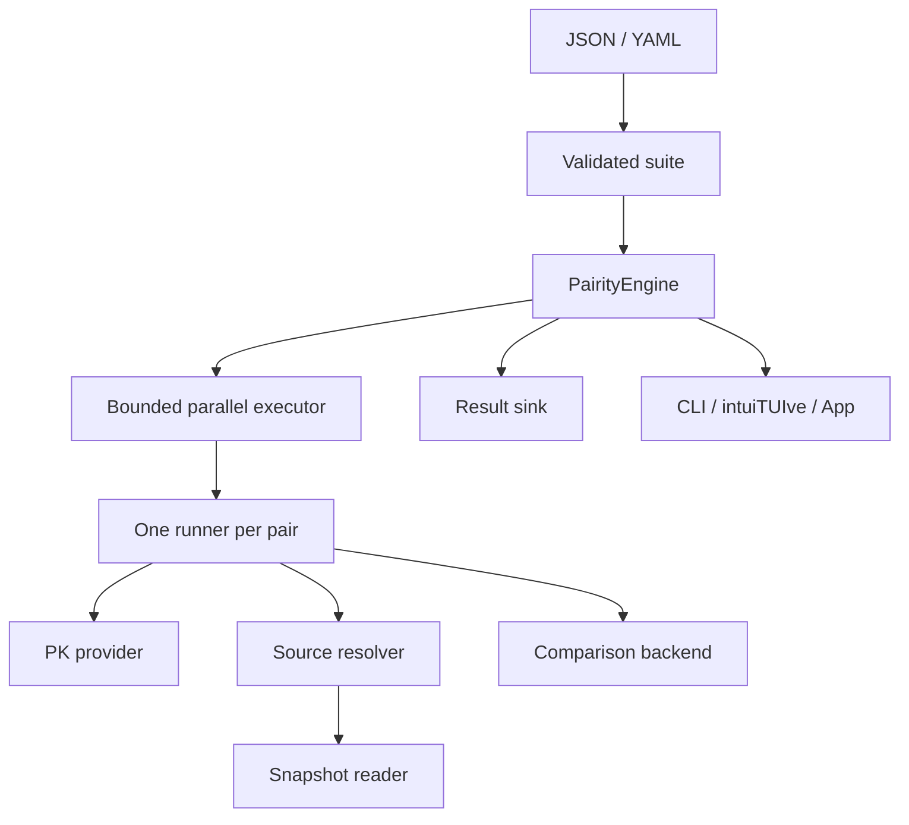

# Architecture and extension contracts

Pairity follows the architecture of [Databricks Labs DQX](https://github.com/databrickslabs/dqx), while owning its regression semantics. The initial reference was DQX commit `6ed782e8c8e5a9b8686db87dc9ae1962972130d0`. No DQX code was copied and no DQX runtime dependency is required.

| DQX boundary | Pairity implementation |
|---|---|
| `config.py`, serializers and check validation | `config.py`, `serialization.py`: one strict model and interchangeable JSON/YAML codecs |
| `checks_storage.py` storage handlers/factories | `ConfigStore`, `FileConfigStore`, pure bulk transforms and explicit plugin registries |
| `DQEngineCore` applying checks to DataFrames | `ComparisonBackend`, initially `SparkComparisonBackend` |
| `DQEngine` composing I/O, checks and results | `ComparisonRunner` and `PairityEngine` |
| Workspace contexts and workflows | Composition in `create_spark_engine`, a Job entry point and deployment bundle |
| Studio over the same library | FastAPI/React workbench over shared services; no duplicated comparison logic |



## Plugins

`contracts.py` defines contract version 1 for metadata, table readers, comparison backends, configuration stores, result sinks, execution backends and pair runners. Configuration imports do not import PySpark or authenticate against a workspace. Platform dependencies live in adapter modules.

Adapters declare `api_version = 1`. Supply them through constructor injection or trusted factory registries. Registry names are opaque names, not Python import paths. Unknown names, duplicate registrations and incompatible versions fail. Entry-point auto-discovery and loading code from configuration are deliberately absent.

```python
from pairity.engine import ComparisonRunner, PairityEngine
from pairity.plugins import PluginRegistry

backends = PluginRegistry()
backends.register("company-comparison", CompanyComparisonBackend)


def runner_factory():
    # These are application-supplied implementations of the published protocols.
    return ComparisonRunner(
        CompanyTableReader(),
        CompanyMetadataProvider(),
        backends.create("company-comparison"),
    )


engine = PairityEngine(runner_factory, sink=CompanyResultSink())
```

Factories must create fresh mutable components per pair. A source provider returning an unpinned input must report `snapshot_pinned=False`; callers can inspect this in results. The built-in Delta reader requires versioned inputs. Direct DataFrame callers own snapshot stability across Spark actions.

Comparison backends own schema/type support, key data validation and comparison semantics. The orchestration layer owns selection, bounded parallelism, isolation, stable ordering and failure aggregation. Sinks run after workers finish, on the orchestrator thread, and must raise on failed persistence. A later DQX adapter must satisfy the same result and capability contracts; it cannot silently skip unsupported columns.

The orchestrator verifies exactly one outcome per selected pair and restores configured order even when an executor returns completion order. It rejects missing/malformed counts, negative/noninteger values, inconsistent row-count identities and passes that exceed configured thresholds. These checks catch adapter contract mistakes; adapters remain trusted application code and are responsible for performing their advertised comparisons and respecting concurrency contracts.

## Parallel execution

The default executor uses a bounded thread pool. Spark's executor additionally captures a distinct copy of the caller's JVM thread properties for each pair using `inheritable_thread_target`. A single wrapped target would share mutable local properties, so each submitted pair has its own target. Pair readers use separate Spark sessions, job groups and scheduler pools; local properties are restored after use.

The initial adapter requires classic Spark with pinned Python/JVM threads. Its compatibility check is confined to the Spark adapter. Physical throughput depends on Spark scheduling and available compute; configure FAIR scheduling before session creation for resource sharing between pairs.

See Spark's [concurrent job scheduling documentation](https://spark.apache.org/docs/3.5.8/job-scheduling.html).

## Scope and next adapters

- Configuration: revisioned local files and shared Postgres/Lakebase application state.
- Comparisons: scalar exact equality and float/double tolerances now. Structs, arrays and maps block explicitly until comparator plugins implement their policies.
- Decimal/integer comparisons preserve exact values. Nonzero tolerances for these types block until precision-safe policies are implemented.
- Results: Delta run envelopes and optional distributed differences, JSON export, SQL history reads and incident archives. Bounded historical sample retrieval remains future work.
- Execution: bounded parallelism and failure isolation now; explicit cancellation, retry policies and remote backends remain tracked in #7.
- CLI: rs-rich for reports and intuiTUIve for saved-report exploration. Both use the published `rs-rich` Python package backed by native Rust; Python Rich/Textual are not used.

The workbench is implemented separately from workspace deployment qualification. See [workbench setup and release gates](workbench.md).

## Hosted execution target

Follow DQX Studio’s separation between the App/API and serverless task-runner Jobs. Pairity’s App or CLI submits a Job; notebook or Python wheel tasks call the reusable comparison library. Job-level pair fan-out provides bounded parallel execution and a final task validates complete result coverage. Classic Spark threading is an optional adapter, not a requirement of the hosted architecture. The default bundle now uses serverless Job fan-out. Submission plugins separately support direct Python/notebook execution, CLI and SDK Jobs submission, and external orchestrators; see [deployment](deployment.md). Live qualification remains in the [Free Edition test plan](free-edition.md).

Source templates expand to typed operations before scheduling. A `SourceResolver` composes pinned leaf inputs through the existing table reader; it never guesses PKs for derived sources. Numeric normalization happens before key validation and comparison and records cast decisions in results. Both comparison logic and source transformations stay in the library, reusable by thin serverless task wrappers.

## Storage boundaries

Postgres/Lakebase holds revisioned application state; a single-transaction Delta envelope holds completed run reports and optional distributed row differences; one or more UC Volumes hold immutable artifact bundles. Postgres stores artifact references, not file bytes. Workers receive immutable config snapshots and do not need Postgres credentials. See [storage setup and guarantees](storage.md).
